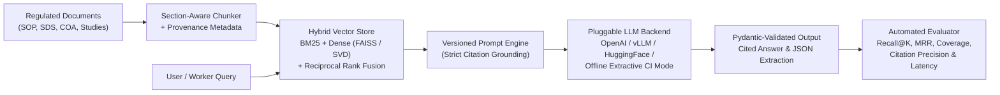

# biomed-rag-doc-intel

**Domain-Adaptive Biomedical Document Intelligence & Modular RAG Pipeline**

A production-structured, reproducible Retrieval-Augmented Generation (RAG) and schema-constrained document extraction framework validated on dense biomedical and regulatory documents (**SOPs, Safety Data Sheets, Certificates of Analysis, and Translational Research Briefs**).

Designed with a **domain-agnostic modular architecture** so the exact same ingestion, hybrid retrieval, grounding, and evaluation stack transfers cleanly to enterprise **Digital Worker** workflows across regulated industries (life sciences, healthcare, chemical compliance, and quality assurance).

---

## Architecture



## Key Features
* **Controlled Chunking Ablations:** Compares `fixed`, `sliding_window`, and `section_aware` chunking with parent document/section provenance tags (`src/biomed_rag/chunking.py`).
* **Hybrid Retrieval with RRF:** Combines Okapi BM25 lexical matching (critical for CAS numbers, lot IDs, gene symbols, and GHS codes) with dense semantic embeddings (`FAISS` + `SentenceTransformers` when installed, or deterministic TF-IDF+SVD for offline/CI execution) fused via Reciprocal Rank Fusion (`src/biomed_rag/vector_store.py`).
* **Strict Citation Grounding & Refusal Guardrails:** Versioned prompt templates (`v1_basic_qa`, `v2_strict_grounding`, `v2_structured_extraction`) enforcing `[DOC_ID | CHUNK_ID]` citations and `INSUFFICIENT_EVIDENCE` refusals on out-of-domain queries (`src/biomed_rag/prompts.py`).
* **Structured Document Extraction:** Parses analytical COA tables, SDS hazards, and SOP QC acceptance criteria into typed Pydantic v2 records (`src/biomed_rag/schemas.py`).
* **Production-Ready Microservice:** Containerized **FastAPI** service (`/health`, `/query`, `/extract/{doc_id}`) with `Dockerfile`, `Makefile`, `pytest` suite, and GitHub Actions CI.

---

## Reproducible Ablation Results (`top_k=3`)

Executed via `python3 scripts/run_ablation.py` on the bundled 4-document regulated biomedical corpus (`SOP-BIO-EV-014`, `SDS-CHEM-DEX-009`, `COA-BIO-CLP-2026-042`, `STUDY-PROT-2026-007`) and 12 ground-truth queries (`data/eval_qa_dataset.json`):

| Experiment | Chunking | Retrieval | Chunks | Recall@3 | MRR | Keyword Coverage | Citation Precision | Avg Latency (ms) |
| :--- | :--- | :--- | ---: | ---: | ---: | ---: | ---: | ---: |
| `fixed_bm25` | fixed | bm25 | 9 | 1.000 | 1.000 | 0.667 | 0.958 | 1.06 |
| `fixed_dense` | fixed | dense | 9 | 1.000 | 1.000 | 0.667 | 1.000 | 2.21 |
| `sliding_hybrid` | sliding_window | hybrid | 10 | 1.000 | 1.000 | 0.667 | 1.000 | 2.34 |
| `section_bm25` | section_aware | bm25 | 24 | 1.000 | 1.000 | **0.861** | 0.931 | 0.53 |
| `section_dense` | section_aware | dense | 24 | 1.000 | 1.000 | **0.861** | 0.931 | 1.65 |
| `section_hybrid` | section_aware | hybrid | 24 | 1.000 | 1.000 | **0.861** | 0.931 | 3.86 |

**Key Takeaway:** Switching from naive fixed/sliding-window chunking to **section-aware chunking with header-context preservation** boosted downstream answer keyword coverage by **+19.4 percentage points (`0.667` → `0.861`)** by keeping structured specifications and compliance bullet points paired with their section headers.

---

## Quickstart (Linux / Docker)

### 1. Local Setup & Verification
```bash
pip install -r requirements.txt
make test        # Runs unit, API, refusal, and quality-floor pytest suite
make ablation    # Regenerates reports/ablation_results.json and .md
make serve       # Launches FastAPI microservice on http://localhost:8000
```

### 2. Docker Deployment
```bash
make docker-build
make docker-run
```

### 3. Switching to Live LLM + Dense GPU Embeddings
Update `configs/rag_config.yaml`:
```yaml
retrieval:
  embedding_backend: sentence_transformers
  embedding_model: BAAI/bge-small-en-v1.5
generation:
  backend: openai_compatible   # or huggingface_local
  model: gpt-4o-mini           # or Qwen/Qwen2.5-3B-Instruct
```
Export `OPENAI_API_KEY` (or point `OPENAI_BASE_URL` to a local `vLLM` / `Ollama` server) and install the optional GPU extras listed in `requirements.txt`.

---

## Repository Structure
```text
biomed-rag-doc-intel/
├── configs/rag_config.yaml          # Reproducible experiment & deployment config
├── data/
│   ├── sample_corpus/               # Biomedical SOP, SDS, COA, and Research Brief
│   └── eval_qa_dataset.json         # 12 ground-truth evaluation queries
├── reports/                         # Generated JSON & Markdown ablation reports
├── scripts/run_ablation.py          # Automated ablation runner
├── src/biomed_rag/
│   ├── api.py                       # FastAPI service (/health, /query, /extract)
│   ├── chunking.py                  # Fixed, sliding-window, and section-aware chunkers
│   ├── evaluator.py                 # Recall@K, MRR, citation precision, ablation matrix
│   ├── generator.py                 # OpenAI/vLLM, HuggingFace, & offline grounded backends
│   ├── pipeline.py                  # End-to-end RAG + structured extraction orchestrator
│   ├── prompts.py                   # Versioned strict-grounding prompt templates
│   ├── schemas.py                   # Pydantic v2 data contracts
│   └── vector_store.py              # BM25 + FAISS/SVD dense + RRF hybrid retriever
├── tests/test_pipeline.py           # Pytest suite (retrieval, refusal, extraction, API)
├── Dockerfile
├── Makefile
└── .github/workflows/ci.yml
```
